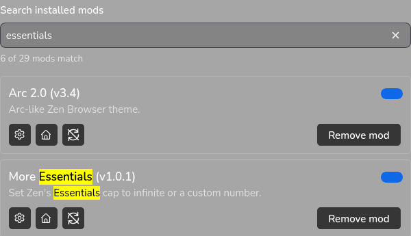

> [!IMPORTANT]
> Sine Mod Search is now part of [Homuzen](https://github.com/homura-ai/homuzen), and this repository is no longer updated. To switch, install `https://github.com/homura-ai/homuzen` in Sine, remove this mod, and turn on **Enable Sine Mod Search** in Homuzen's settings. Your settings carry over.

# [Sine Mod Search](https://github.com/homura-ai/sine-mod-search)

Adds a search field above **Settings → Sine Mods → Installed Mods** in Zen.
Search mod names, descriptions, settings labels, preference keys such as
`uc.sidebar.position`, and dropdown option labels/values. Search ignores case
and accents; every word must match somewhere in the same mod. Clear the field
or press Escape to restore the full list.

Matching cards retain Sine's normal Configure, enable, update, and remove controls.
Settings are indexed from local installed preference files, including disabled
mods and settings that have not been opened. The mod does not change preferences,
enable other mods, or send search text anywhere. Results filter whole mod cards,
and the matching words are highlighted in each card and inside its Configure
popup, without changing the popup's controls. Sine only builds a disabled mod's
popup after it is enabled, so those settings match but have no popup text to mark.

The [README](https://raw.githubusercontent.com/homura-ai/sine-mod-search/main/README.md)
and preview image are also linked from the mod metadata.

## Installation

Enter `https://github.com/homura-ai/sine-mod-search` in Sine's custom GitHub repository
installer. Allow JavaScript mods from unofficial sources if Sine requests it.
Reopen Settings if needed. No build step is required, and `package.json` and
`tests/` are only for development.

## Compatibility and checks

Targets Sine's `#sineModsList` / `.sineItem[mod-id]` settings UI and local mod
metadata API, checked against [Sine source](https://github.com/CosmoCreeper/Sine/tree/fb0bd4ca6af888f10648e126947f7d1f82228433/src).
Verified on Zen **1.24.2b** with Sine/Cosine **2.3.4.1c** on 2026-11-16,
using a temporary copy of an installed profile. Name, settings-label, preference-key,
and disabled-mod settings searches worked across 29 mod cards. Card and Configure
popup highlights, native popup controls, and Escape clearing also passed.
Works in `about:preferences` and `about:settings`, waiting for Sine's asynchronously
created UI. Sine/Cosine versions that change these internal APIs may need an update.
The search reindexes when Sine rebuilds the installed list or the settings window
regains focus. Disabling or removing the mod removes its UI and filtering.

Run `npm install`, then `npm test`. The DOM tests cover name and settings search,
highlighting in cards and settings popups,
disabled mods, preference keys, dropdown options, delayed UI creation, rebuilt
lists, incomplete preference files, Escape, reload, and unloading during indexing.
They simulate browser APIs; they do not establish live Firefox/XUL compatibility.

Live smoke test after installation:

1. Search for a mod name, a settings label, and a raw preference key. Check that
   the words are highlighted in the cards and in the matching mod's Configure popup.
2. Search for a setting in a disabled mod before opening its Configure dialog.
3. Open Configure on an enabled matching mod and verify its controls still work.
4. Search for a nonexistent term, then clear with Escape.
5. Install/remove another mod with the search active and verify the results refresh.
6. Disable this mod and verify all cards reappear and the search field disappears.
7. Repeat in a second settings tab and after a browser restart.

For each later publication, increase `version` and set `updatedAt` strictly later
than the published timestamp (use an ISO timestamp for same-day updates). Test
with the old version installed: Sine must discover the newer `updatedAt` at
`homepage`, download the changed script, and apply it. This installed update path
still needs verification with an installed release in a live Zen profile.
